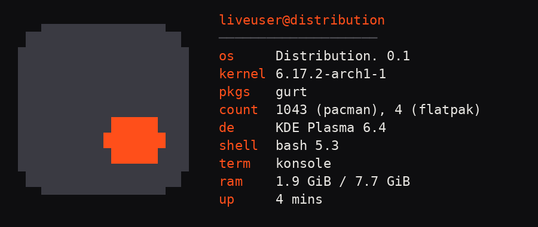

# Distribution.


a linux distribution. period.

- **Arch-based**, rolling
- **KDE Plasma** desktop
- **[gurt](https://github.com/clrealy/GURT) is the package manager** 🦆 — type `pacman` and it gets translated to gurt (real pacman still runs underneath)
- custom Plymouth boot splash where the period drops in, fastfetch logo, and wallpaper



## Build the ISO

You need an **Arch Linux** machine (a VM works) with ~15 GB free.

```
git clone https://github.com/clrealy/distribution
cd distribution
chmod +x build.sh
./build.sh
```

The ISO lands in `out/`. Boot it in a VM first.

## What's in here

| path | what |
| --- | --- |
| `build.sh` | builds the ISO with archiso |
| `branding/plymouth/` | the animated boot splash |
| `branding/syslinux/` | bootloader menu background |
| `branding/fastfetch/` | fastfetch logo + config |
| `branding/wallpaper/` | the default KDE wallpaper |


MIT © clearly124
